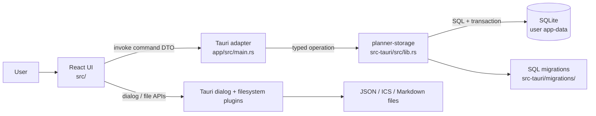
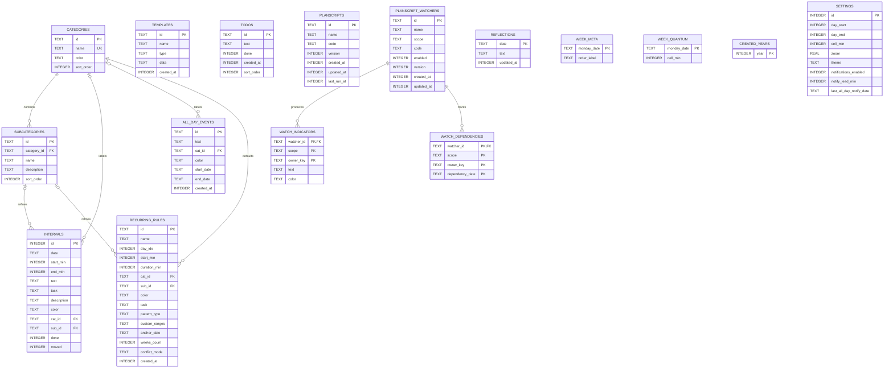
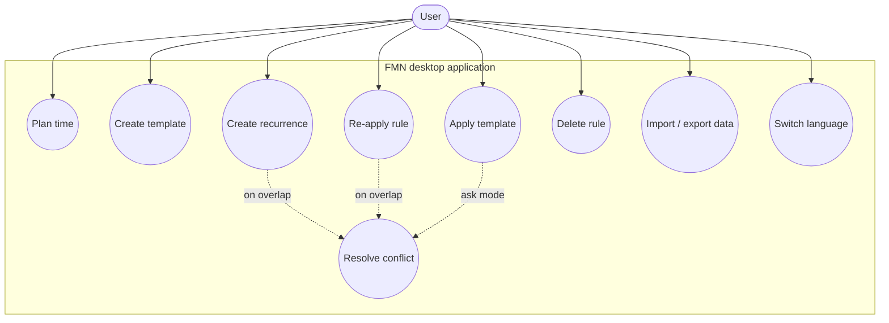
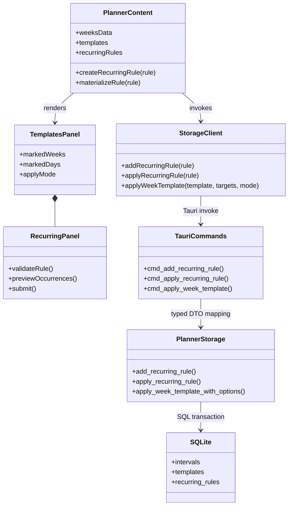

# Architecture

## Context and execution flow



React is responsible for the screen, input, local reactive state, and invocation of Tauri commands. The Tauri adapter validates and transforms the transport DTO. The Rust storage library contains SQLite operations and transactions. File dialogs and file access are provided by the official Tauri plugins.

## SQLite ER diagram



Templates and recurring rules are intentionally not foreign keys to created intervals. Applying a template or rule creates independent `intervals` rows; therefore deleting the template or rule does not remove calendar data. FTS5 `intervals_fts` and its supporting triggers are used for interval search. PlanScript, watchers, and their indicators were added via subsequent migrations; the full DDL is the source of truth in `src-tauri/migrations/`. `settings` is a single row with `id = 1`, while `created_years`, `week_quantum`, and `week_day_bounds` are not connected to calendar intervals; they are navigation data and week display settings.

## UML: functional model



## UML: class/module diagram



## UML: recurring creation sequence

```mermaid
sequenceDiagram
    actor User as User
    participant UI as RecurringPanel
    participant P as PlannerContent
    participant T as Tauri command
    participant S as planner-storage
    participant DB as SQLite
    User->>UI: Fills the rule
    UI->>UI: Validates range, time, and pattern
    UI->>User: Shows recurring count and requests confirmation
    alt User cancelled
        User-->>UI: Cancel
        UI-->>User: No data changed
    else Confirmed
        UI->>P: onCreate(rule)
        P->>T: cmd_add_recurring_rule
        T->>S: add_recurring_rule
        S->>DB: INSERT recurring_rules
        DB-->>S: commit
        S-->>P: success
        P->>T: cmd_apply_recurring_rule
        T->>S: apply_recurring_rule(spec)
        S->>DB: BEGIN; write matching intervals
        S->>DB: COMMIT
        DB-->>P: processed recurring count
        P->>T: reload affected weeks
        P-->>UI: show result / update error
    end
```

## Repository structure and build

```text
src/                         React UI + client model
  components/                separate panels and widgets
  script/                    PlanScript lexer/parser/interpreter
src-tauri/                   Rust storage crate
  migrations/                SQL schema migrations
  tests/                     SQLite integration tests
app/                         Tauri executable crate + frontend host
  src/main.rs                commands, plugins, DB initialization
  capabilities/              Tauri permissions
  frontend/index.html        React mount point
tests-frontend/              Node tests and jsdom integration harness
docs/                        architecture diagrams
```

1. `npm ci` restores frontend/tooling dependencies.
2. `npm run build` runs esbuild and writes `app/frontend/bundle.js`.
3. `app/tauri.conf.json` sets `app/frontend` as `frontendDist`; the pre-build hook builds the bundle from the root npm project.
4. Cargo builds both `app/` and the local `src-tauri/` library. Rust wires in bundled SQLite, applies migrations, and produces MSI/NSIS installers.

See the root [README](../README.md) for development commands and [requirements](./requirements.md) for user scenarios and acceptance criteria.
