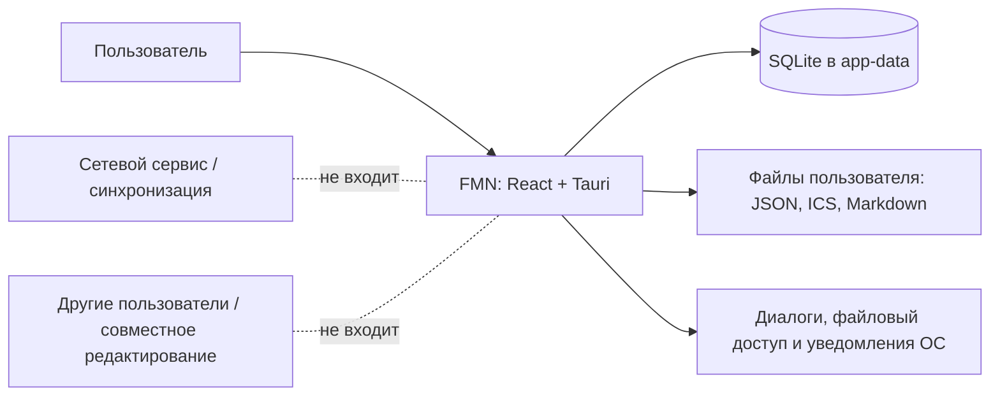

# Контекст и границы системы

## Назначение

FMN (Forget-me-not, «Незабудка») — локальное настольное приложение для планирования времени по неделям. Пользователь распределяет занятия по временным интервалам, повторно использует шаблоны, создаёт конечные серии повторов и анализирует расписание.

## Цель и ожидаемый результат

Основная цель — дать одному пользователю надёжный офлайн-инструмент для ведения недельного расписания и сохранить согласованность локальных данных при обычных и пакетных изменениях. Критичные для этого свойства: понятный предпросмотр существенных изменений, отмена там, где она поддержана, явное сообщение об ошибке и атомарность backend-пакетных операций.

## Заинтересованные стороны

| Сторона | Интерес |
|---|---|
| Пользователь приложения | Планирование, быстрый просмотр занятости, сохранность данных, понятные ошибки и локализация. |
| Разработчик/сопровождающий | Поддерживаемая модель данных, миграции без потери данных, тестируемые операции и воспроизводимая сборка. |
| Операционная среда | Windows x64, Tauri 2, WebView2 и локальное хранилище приложения. Поддержка иных ОС не считается подтверждённой. |

В текущей модели нет отдельных ролей администратора, совместных пользователей или удалённого оператора.

## Контекст и границы

### Внутри системы

- Недельный календарь и управление временными интервалами.
- Категории и подкатегории, задачи без времени, события на весь день и рефлексии.
- Шаблоны и правила повторов с конечным применением к календарю.
- Поиск, сводки/трекер, локальные настройки и локализация.
- PlanScript: редактор сценариев, чтение/симуляция, применение доступных операций и наблюдатели в пределах реализованного runtime.
- SQLite persistence, миграции, резервное копирование и поддерживаемые сценарии импорта/экспорта.

### Вне системы

- Учётные записи, удалённое хранение и межустройственная синхронизация.
- Совместное редактирование и управление конфликтами между пользователями.
- Гарантированная доставка уведомлений при закрытом приложении.
- Неограниченные или автоматически поддерживаемые правила повторов.
- Полная совместимость с любыми возможностями сторонних календарных форматов.

## Допущения

1. Данные принадлежат локальному профилю ОС и доступны через каталог данных Tauri.
2. Пользователь работает с одной локальной копией приложения; параллельная многопользовательская запись не является сценарием проекта.
3. Календарная сетка показывает неделю с понедельника по воскресенье; временные записи хранятся как интервалы, а не как клетки.
4. Слова «предпросмотр», «отмена» и «атомарность» относятся к конкретному действию и его реализации; наличие одного свойства не подразумевает автоматического наличия остальных.
5. Точный объём поддержки файлов ICS ограничен реализованным парсером и текущей моделью события.

## Открытые продуктовые вопросы

- Нужны ли измеримые цели производительности для больших исторических календарей?
- Следует ли усилить процесс подтверждения восстановления JSON-копии, которое заменяет текущие данные?
- Нужен ли общий журнал происхождения событий, созданных из шаблонов/повторов/сценариев?
- Какие платформы, кроме Windows x64, следует официально поддерживать?
