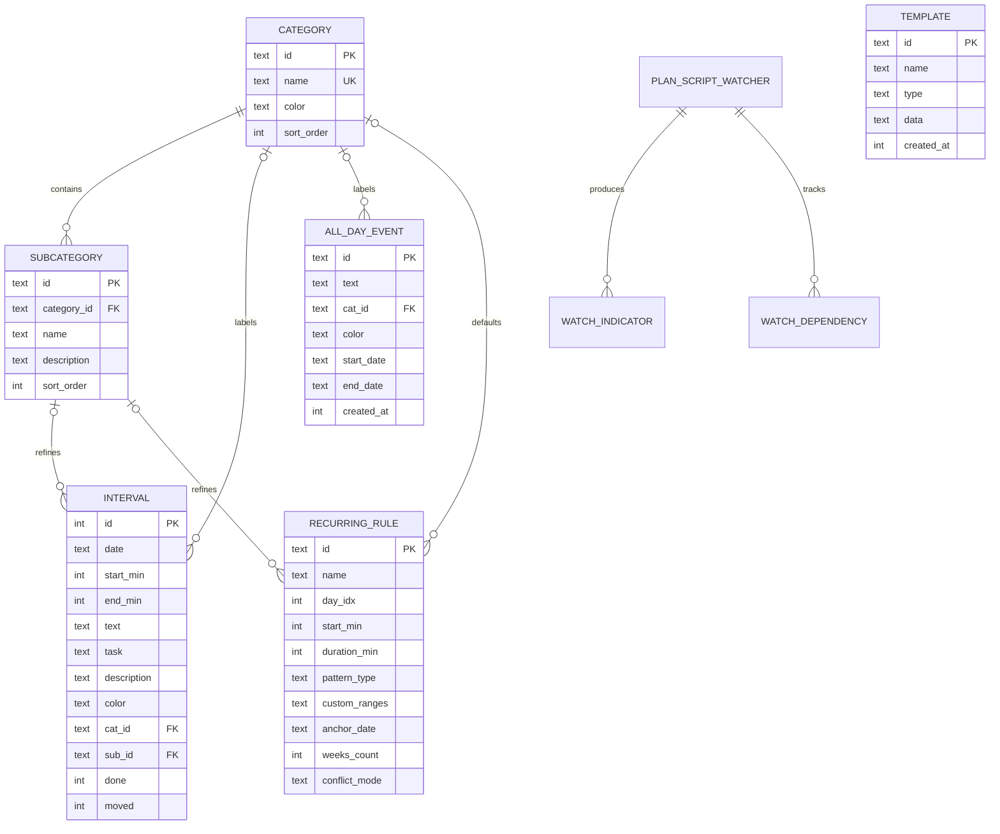

# Модель предметной области

## Термины

| Термин | Определение |
|---|---|
| Интервал | Запланированный участок времени в конкретную дату, с границами в минутах от полуночи. |
| Категория | Группа/цвет для записи расписания; может иметь подкатегории. |
| Подкатегория | Уточнение категории с собственным именем, описанием и порядком сортировки. |
| Событие на весь день | Датированное событие вне временной сетки; может охватывать несколько дней. |
| Задача без времени | Элемент списка задач, ещё не размещённый в календарной сетке. |
| Шаблон | Сохранённый снимок дня или недели для разового применения к календарю. |
| Правило повтора | Конфигурация конечной серии; при создании/повторном применении подходящие записи материализуются как самостоятельные интервалы. |
| Наблюдатель | Сохранённый PlanScript-блок, который вычисляет собственный индикатор дня или недели; не является интервалом календаря. |
| Настройки недели | Параметры отображения конкретной недели, включая шаг сетки и переопределение границ дня. |

## Концептуальные связи

Диаграмма показывает основные связи, а не все таблицы и ограничения. Полная обзорная схема — в [архитектуре](./architecture.md); канонический DDL — в `src-tauri/migrations/`.

## Основные группы данных

| Группа | Таблицы/источник | Назначение и особенность |
|---|---|---|
| Расписание | `intervals`, `all_day_events` | Временные интервалы и события на целые даты — разные сущности. Пустое время не хранится. |
| Классификация | `categories`, `subcategories` | Категории используются интервалами и событиями на весь день; удаление категории может отвязать её от записей. |
| Задачи | `todos` | Список задач без назначенного времени; отдельно от календарных интервалов. |
| Повторное использование | `templates`, `recurring_rules` | Снимки и правила независимы от уже созданных интервалов; связь происхождения материализованных интервалов не хранится как FK. |
| Сценарии | `planscripts`, `planscript_watchers`, `watch_indicators`, `watch_dependencies` | Сохранённый код, конфигурация наблюдателей, вычисленные индикаторы и зависимости. |
| Служебные данные | `settings`, `reflections`, `week_meta`, `week_quantum`, `week_day_bounds`, `created_years` | Настройки, заметки по датам, навигация и параметры отображения недель. |

Список приведён по миграциям; точные поля и ограничения могут дополняться следующими версиями схемы. Смотрите актуальные SQL-файлы.

## Инварианты и бизнес-правила

1. Временной интервал — полуоткрытый диапазон `[start, end)`. Соприкасающиеся интервалы не пересекаются.
2. Время хранится в минутах от полуночи; для интервалов границы кратны пяти минутам, конец строго больше начала.
3. Интервал относится к одной календарной дате; свободное время отдельной строкой не хранится.
4. Уникальность начальной границы интервала на дату и прочие SQL-ограничения задаются миграциями.
5. Шаблон и правило повтора не являются владельцами созданных записей. Удаление шаблона/правила не откатывает их прежнее применение.
6. Повтор конечен: текущий пользовательский горизонт ограничен 1–520 неделями. Первой выбранной неделе соответствует номер 1 для пользовательского шаблона недель.
7. Режим наложения шаблона заменяет только пересекающийся участок; режим полной замены предварительно очищает целевое окно.
8. Изменения пользовательского интерфейса и persistence должны оставаться согласованными при ошибках; поведение отката и Undo определяется конкретным потоком, а не только моделью данных.

## Источник истины

Для точного определения формата таблиц и каскадного поведения используйте `src-tauri/migrations/*.sql`; для правил операций — `src-tauri/src/lib.rs` и тесты хранилища. Описательная модель выше намеренно не дублирует полный DDL.
